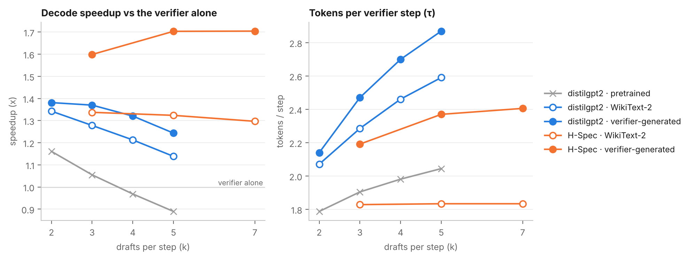
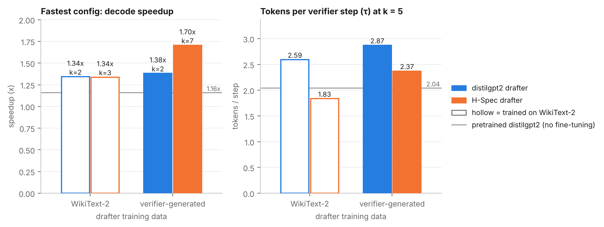
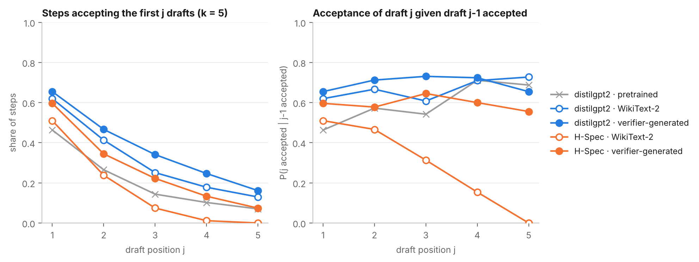
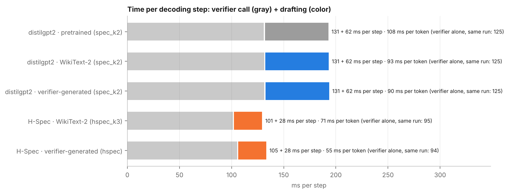
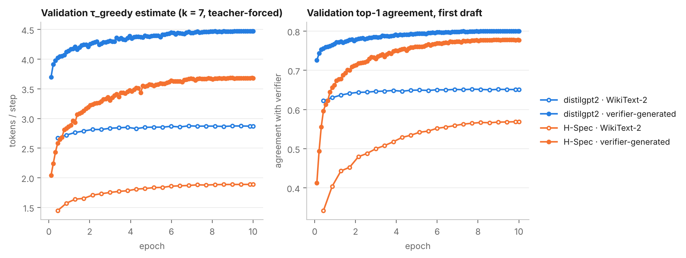
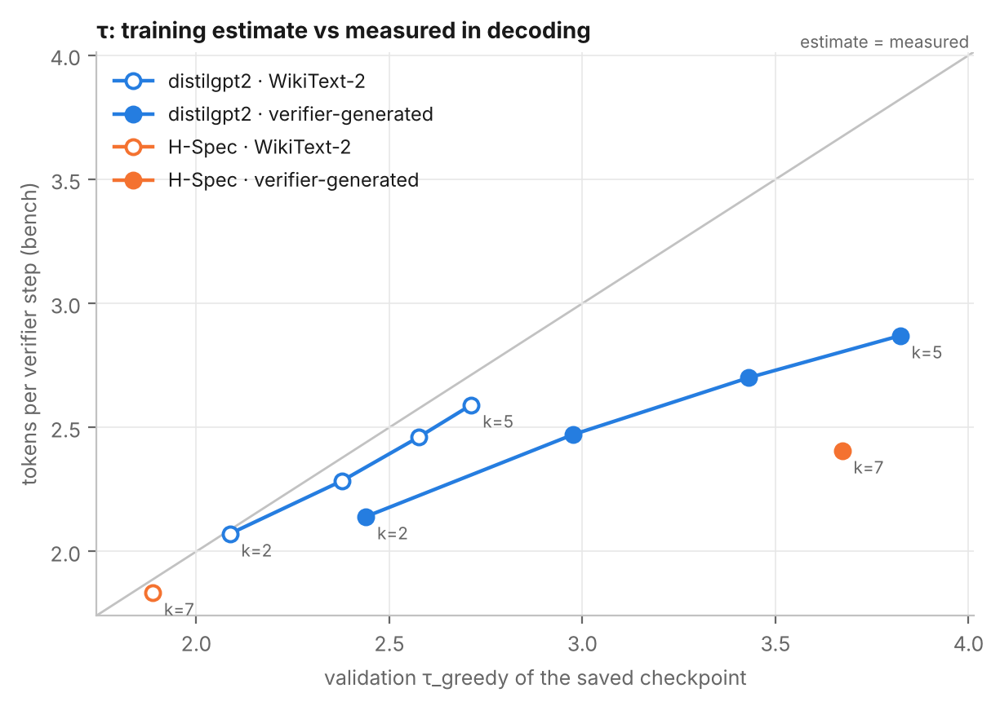
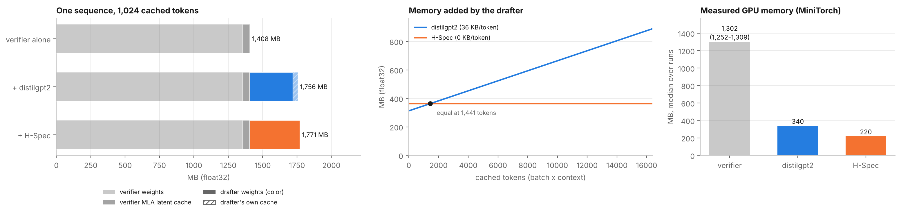

# Drafter ablation: the figures

This page explains the figures of the drafter ablation (`eval.sh`) and what they show. The figures are in
`results/figures_paired/`, drawn by `plot.py` from `results/eval_paired.jsonl` (decoding and memory
rows), `results/memory.json` (exact parameter and cache counts) and the four training runs'
`loss_history.json`:

```bash
python plot.py --results results/eval_paired.jsonl --out results/figures_paired --memory results/memory.json
```

## Setup and conventions

The verifier is the MLA GPT-2 medium (24 layers, 355.6M parameters). Four fine-tuned drafters are
compared, crossing architecture with training data:

| | trained on WikiText-2 | trained on verifier-generated text |
|---|---|---|
| distilgpt2, classic autoregressive drafter | `distil-wikitext` | `distil-gen` |
| H-Spec block drafter (reads the verifier's latent cache) | `hspec-wikitext` | `hspec-gen` |

`distilgpt2-pretrained` (no fine-tuning) is the reference. All four fine-tuned drafters start
from distilgpt2 and use the same loss (0.1 CE + 0.9 TV against the verifier), batch, schedule and
10 epochs. Each config decodes the same 10 WikiText-2 prompts (64 tokens) with 64 new tokens,
greedily, in MiniTorch (batch 1, float32). Every output equals the verifier's own greedy output,
so all speedups are lossless.

- **Colours**: blue = distilgpt2 drafter, orange = H-Spec drafter, gray = pretrained distilgpt2 or the
  verifier. **Hollow** marks and bars = trained on WikiText-2, **filled** = trained on
  verifier-generated text.
- **k** = drafts per decoding step. distilgpt2 runs k = 2-5. H-Spec runs k = 3, 5 and 7, where
  7 is its block size.
- **τ** (tokens per verifier step) = accepted drafts + 1 (the verifier's own token), averaged over
  steps. It does not depend on timing.
- **Speedup** = decode tokens/s against the verifier decoding alone (`ar_target`). The baseline is
  timed in the **same bench run** as the config (paired), so the comparison holds even though
  absolute speeds differed between runs (see [Caveats](#caveats)).

## 1. Speedup and τ against k (`speedup_tau.png`)



**What it shows.** Left: decode speedup for each drafter at each k (above the "verifier alone" line
= faster than no speculation). Right: τ for the same configs.

**Analysis.**
- **distilgpt2 gets slower as k grows, although τ keeps rising.** For `distil-gen`, τ goes
  2.14 → 2.47 → 2.70 → 2.87 from k = 2 to 5, while speedup goes 1.38 → 1.37 → 1.32 → 1.24.
  Each extra draft costs another distilgpt2 forward (~31 ms), but at k = 5 it adds only 0.17
  tokens per step. The pretrained distilgpt2 drops below the verifier alone from k = 4
  (0.97×, then 0.89× at k = 5).
- **H-Spec's drafting cost does not grow with k**, because one pass drafts the whole block. So a τ
  gain is nearly free, and `hspec-gen` improves with k: 1.60× (k = 3), 1.70× (k = 5), 1.70×
  (k = 7). It plateaus because τ saturates (2.37 → 2.41) while the verifier call grows slightly
  with the number of tokens it scores (103 → 105 ms).
- **`hspec-wikitext` is flat at τ = 1.83 for every k**: drafts beyond the third are almost never
  accepted (figure 3), so longer blocks buy nothing. Its speedup only falls a little
  (1.34 → 1.30), from the slightly longer verifier call.
- **At equal k, distilgpt2 has the higher τ** (k = 5: 2.87 vs 2.37 on generated data, 2.59 vs
  1.83 on WikiText), yet H-Spec is faster on generated data. Acceptance alone does not decide
  speed; the cost of drafting does.

## 2. The 2×2 ablation (`ablation.png`)



**What it shows.** Left: each fine-tuned drafter's best speedup (the k of that config under the
value). Right: τ at a common k = 5. The gray line is the pretrained distilgpt2 (1.16×; τ 2.04).
The numbers are also in `results/figures_paired/ablation.md`.

**Analysis.**

| best speedup | WikiText-2 | verifier-generated | data effect |
|---|---|---|---|
| distilgpt2 | 1.34× (k = 2) | 1.38× (k = 2) | +0.04× |
| H-Spec | 1.34× (k = 3) | 1.70× (k = 7) | +0.36× |
| architecture effect | 0 | +0.32× | |

- **The two factors interact.** With WikiText training the architectures tie. H-Spec's advantage
  appears only with verifier-generated data, which helps H-Spec nine times more than it helps
  distilgpt2.
- **For distilgpt2, fine-tuning against the verifier matters more than the data**: 1.16× → 1.34×
  from fine-tuning, then only +0.04× from switching to generated text.
- **H-Spec ties distilgpt2 on WikiText despite a much lower τ.** At k = 5 its τ is 1.83, below
  even the pretrained distilgpt2's 2.04. It still matches the fine-tuned distilgpt2's 1.34×
  because its drafting is cheap: one 28 ms pass, against 62 ms for two distilgpt2 drafts.

## 3. Acceptance by draft position (`acceptance.png`)



**What it shows.** Both panels use the k = 5 configs. Left: the share of decoding steps whose first
j drafts were all accepted, a survival curve. Summing it over j gives the mean accepted drafts, so
τ = 1 + that sum; for example `distil-gen` has 1 + 0.655 + 0.466 + 0.341 + 0.247 + 0.161 = 2.87.
Right: the acceptance of draft j given that draft j−1 was accepted.

**Analysis.**

| k = 5 | P(accept draft j given j−1 accepted), j = 1..5 | steps accepting all 5 |
|---|---|---|
| distilgpt2, pretrained | 0.46, 0.57, 0.54, 0.71, 0.69 | 7% |
| distilgpt2, WikiText-2 | 0.62, 0.67, 0.61, 0.71, 0.73 | 13% |
| distilgpt2, generated | 0.66, 0.71, 0.73, 0.72, 0.66 | 16% |
| H-Spec, WikiText-2 | 0.51, 0.47, 0.31, 0.15, 0.00 | 0% |
| H-Spec, generated | 0.60, 0.58, 0.65, 0.60, 0.56 | 7% |

- **distilgpt2's conditional acceptance stays flat or rises with depth.** It drafts one token at a
  time and conditions on its own earlier drafts, so once it is on the verifier's track it tends to
  stay there.
- **H-Spec drafts all positions in parallel**, so draft j sees only placeholders for the drafts
  before it. Trained on WikiText it collapses with depth (0.51 → 0.00); of 349 steps, none accepted
  all five drafts. Trained on verifier-generated text it holds 0.55-0.65 at every depth. This is
  the main effect of the data: it teaches H-Spec the verifier's own continuation habits, which it
  needs to guess several tokens ahead without seeing its earlier drafts.
- **The first draft is the hardest for distilgpt2**, most visibly the pretrained one (0.46, then
  about 0.55-0.7). That fits: the first draft comes right after a rejection (see figure 6).
- Deep positions rest on few steps (for `hspec-wikitext`, the conditionals at j = 4 and 5 come from
  the 83 and 26 steps that got that far), so they are noisy. The last step of each prompt may draft fewer than k
  tokens, which lowers the deepest positions slightly.

## 4. Time per decoding step (`step_time.png`)



**What it shows.** For each drafter's fastest config, one decoding step split into the verifier
call (gray) and drafting (colour). The labels give ms per generated token, and the verifier-alone
ms per token measured in the same bench run.

**Analysis.**
- **Speedup is τ × (verifier-alone time per token) / (step time).** For `distil-gen` at k = 2 that is
  2.14 × 125 / (131 + 62) = 1.39×. For `hspec-gen` at k = 7 it is 2.41 × 94 / (105 + 28) = 1.70×.
  These reproduce the measured speedups.
- **Drafting share.** distilgpt2 spends 32% of each step drafting at k = 2 and 53% at k = 5;
  H-Spec spends 21% at any k. That is why the best k is 2 for distilgpt2 and 5-7 for H-Spec.
- **Verifying several tokens costs about the same as decoding one.** Within a run, a verifier call
  on k + 1 tokens costs 1.03-1.06× a one-token call. MiniTorch at batch 1 is bound by per-call
  overhead rather than arithmetic. Speculative decoding helps at all because of this, and it is
  also why an 8-position H-Spec pass (28 ms) costs about one distilgpt2 token (31 ms).
- **The verifier call is 131 ms in the distilgpt2 runs but 101-105 ms in the H-Spec runs.** The
  same split shows in the baselines (125 vs 94 ms per token), so it affects the whole run, baseline
  included; see [Caveats](#caveats). The paired baselines absorb it.

## 5. Training curves (`training.png`)



**What it shows.** Validation metrics of the four fine-tuning runs against epoch. Left: the
teacher-forced τ estimate at k = 7, which is comparable across architectures. Right: top-1
agreement with the verifier on the first draft (H-Spec's first block position, distilgpt2's next
token).

**Analysis.**

| run | τ estimate (k = 7): first eval → best | first-draft top-1: first → best | best at epoch | steps |
|---|---|---|---|---|
| distilgpt2, WikiText-2 | 2.67 → 2.87 | 0.62 → 0.65 | 7.7 | 11,680 |
| distilgpt2, generated | 3.70 → 4.47 | 0.73 → 0.80 | 9.0 | 46,720 |
| H-Spec, WikiText-2 | 1.45 → 1.89 | 0.34 → 0.57 | 9.0 | 11,680 |
| H-Spec, generated | 2.04 → 3.67 | 0.41 → 0.77 | 7.0 | 46,720 |

- **distilgpt2 starts high and gains little**, because it is a complete pretrained language model.
  **H-Spec starts low and gains a lot**: only its trunk comes from distilgpt2, and the attention
  that reads the verifier's latents is learned from scratch. Training therefore matters much more
  for H-Spec, and so does what it is trained on.
- **On generated data H-Spec nearly closes the first-draft gap** (0.77 vs 0.80). Its remaining
  τ deficit comes from deeper positions: at the best checkpoint, its top-1 agreement by block
  position is 0.77, 0.65, 0.56, 0.48, 0.42, 0.37, 0.32. On WikiText it is 0.57, 0.33, 0.22, 0.16,
  0.14, 0.12, 0.12.
- **All four runs reach 95% of their final gain by epoch 6-7**, so they are close to converged.
  More epochs on the same data would add little; more data or a larger drafter might.
- The generated-data runs take four times as many steps, because the stride-32 set has 74,745 rows
  against about 18.7k WikiText blocks.
- Curves on different data do not compare level for level, because each is measured on its own
  validation set. Verifier-generated text is more predictable (greedy output repeats), so its
  estimates are higher for any drafter.

## 6. Training estimate against measured τ (`estimate_vs_measured.png`)



**What it shows.** Each point pairs the τ estimated at the saved checkpoint (x) with the τ measured
in decoding (y) at the same k. The diagonal is "estimate = measured". distilgpt2 has points for
k = 2-5. H-Spec's training estimate exists only at its block size, so it has one point at k = 7.

**Analysis.**

| run | k | estimate | measured | measured / estimate |
|---|---|---|---|---|
| distilgpt2, WikiText-2 | 2 / 5 | 2.09 / 2.71 | 2.07 / 2.59 | 0.99 / 0.96 |
| distilgpt2, generated | 2 / 5 | 2.44 / 3.82 | 2.14 / 2.87 | 0.88 / 0.75 |
| H-Spec, WikiText-2 | 7 | 1.89 | 1.83 | 0.97 |
| H-Spec, generated | 7 | 3.67 | 2.41 | 0.66 |

- **Every point lies below the diagonal: the training estimate is optimistic.** It averages over
  every start position of the validation rows. Decoding starts each step right after a rejection,
  and rejections cluster in hard stretches, so the positions decoding visits are harder than
  average. Easy stretches, such as the verifier's repetitive loops, get crossed in a few long
  steps but count at every position in the estimate.
- **The bias is large for the generated-data runs** (0.66-0.88) and small for the WikiText runs
  (0.96-0.99). Verifier-generated validation rows contain the long easy stretches that inflate a
  uniform average. On WikiText the estimate is measured on human text, which is harder and more
  uniform than the verifier's continuations decoding sees, which probably offsets the bias.
- **Within an architecture the ranking holds**, so the estimate is fine for choosing checkpoints
  but not for predicting speed. An exact greedy estimate would simulate decoding along each
  verifier-generated validation row: start after the prompt, accept the run of agreements, jump
  past it, repeat.

## 7. Memory (`memory.png`)



**What it shows.** Left: what one sequence with 1,024 cached tokens holds in float32: verifier
weights and its MLA latent cache (gray), plus the drafter's weights and its own cache (colour,
hatched). Middle: the memory each drafter adds as the number of cached tokens (batch × context)
grows. Right: GPU memory measured in MiniTorch around loading each model, as a median over runs.
The left and middle panels are exact counts from the model configs (`results/memory.md`).

**Analysis.**

| | parameters | weights | own cache per token | measured GPU (MiniTorch) |
|---|---|---|---|---|
| MLA verifier | 355.6M | 1,357 MB | 51 KB (13,056 floats) | 1,302 MB |
| distilgpt2 drafter | 81.9M | 312 MB | 36 KB (9,216 floats) | 340 MB |
| H-Spec drafter | 95.2M | 363 MB | none | 220 MB |

- **H-Spec has more weights but no cache.** Its token embedding table (38.6M parameters) is 40% of
  its weights; the attention reading the verifier's latents and the fusion of the verifier's hidden
  states add 20.6M and 6.0M. It reads the verifier's latent cache, hidden states and output layer
  (51.5M parameters) in place.
- **Crossover at 1,441 cached tokens.** Below it H-Spec adds more (1,024 tokens: 363 vs 348 MB),
  above it less. At batch 16 × 1,024 tokens distilgpt2 adds 888 MB and H-Spec 363 MB.
- **On the GPU, H-Spec is the smaller drafter** (220 vs 340 MB). MiniTorch uploads only matmul
  weights. H-Spec's embedding table is only looked up and stays on the host, while distilgpt2
  needs its own 154 MB output layer on the GPU. The measured values are the uploaded weights
  (expected 1,255 / 309 / 189 MB) plus 30-50 MB of allocation overhead.
- **MLA is what makes cache sharing pay off.** The verifier's latent cache (51 KB/token) is 3.76×
  smaller than GPT-2 medium's MHA cache would be (192 KB/token). A classic drafter's own cache
  would add another 70% on top of it; H-Spec adds nothing.
- Not included: transient memory (activations; the `kv_up` weights the MLA kernel copies to the GPU
  on every call, about 100 MB per verifier forward).

## Conclusions

1. **Verifier-generated training data is what makes H-Spec win:** 1.70× against 1.38× for the best
   distilgpt2 drafter. With WikiText training both reach 1.34×.
2. **distilgpt2 accepts more drafts, but H-Spec drafts more cheaply.** distilgpt2 conditions on its
   own drafts (higher τ at equal k), but pays one forward per draft. H-Spec drafts a whole block in
   one pass, so it can use k = 5-7.
3. **H-Spec's remaining weakness is depth**: per-position acceptance falls from 0.77 to 0.32 across
   its block even on generated data. Improving deep positions is the lever for more speed.
4. **Memory favours H-Spec once batch × context passes about 1,441 tokens**, and on the GPU in
   MiniTorch it is already the smaller drafter.
5. **Training-time τ estimates overestimate decoding**, by up to a third on generated data. Use
   them to rank checkpoints, not to predict speed.

## Caveats

- **Small sample:** 10 prompts × 64 new tokens per config, greedy only. Sampling (`TEMPS=1.0`) was
  not run.
- **MiniTorch at batch 1, float32** is bound by per-call overhead, so the cost ratios between
  verifier, drafter and k differ from an optimized framework.
- **Timing differed between runs:** the verifier alone ran at 125 ms per token in the three
  distilgpt2 runs and 94-95 ms in the two H-Spec runs, in both executions of the benchmark. The
  H-Spec runs came last both times, so this may be the machine over time rather than the drafter.
  Speedups use each run's own baseline and compare fairly; absolute tok/s and ms across runs do
  not. Running an H-Spec bench before a distilgpt2 one would tell which it is.
- **Different training lengths:** the generated-data runs trained four times as many steps, since
  the stride-32 set is larger. Both data sources ran 10 epochs.
